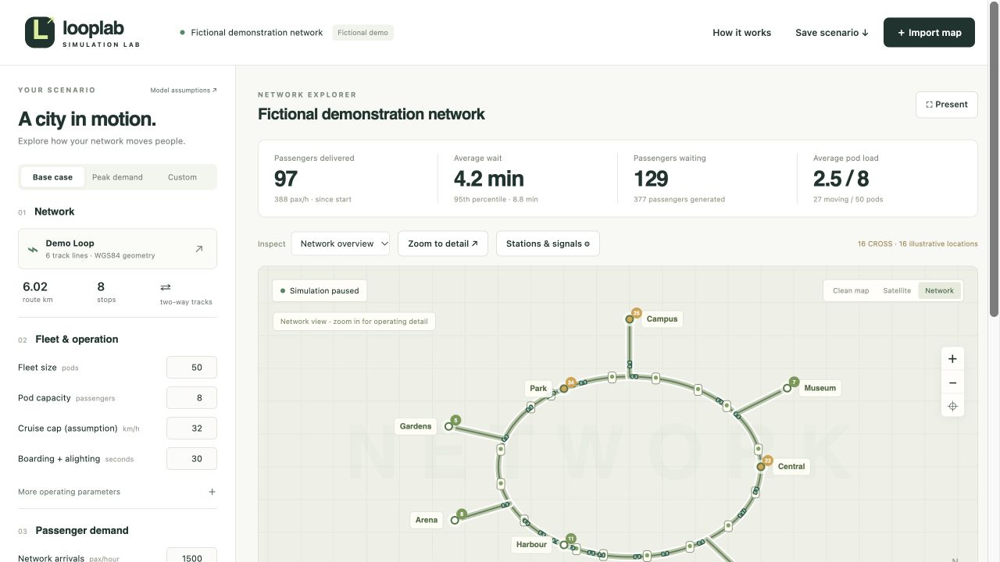
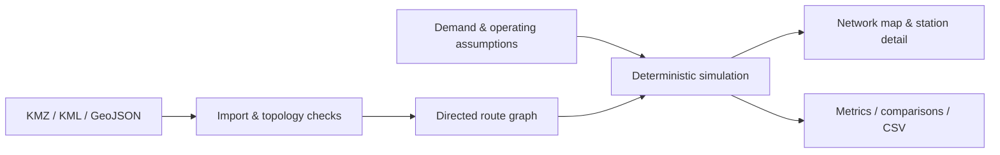

# LoopLab · Pod Transit Simulator

[](https://github.com/alisammarraie/looplab/actions/workflows/checks.yml)

**Turn a track map into an interactive demonstration of small automated transit operations.**

[Open the simulator](https://alisammarraie.github.io/looplab/src/) · [Download the single-file edition](LoopLab.html) · [Fictional sample map](src/demo.geojson)



LoopLab explores how fleet size, demand, station queues and road crossings affect a pod transit network. It includes a newly generated fictional loop with five branches and eight stops. No client geometry, reports or supplier material is included.

## What you can explore

- **Shared or private trips:** pool passenger requests with the same destination, or allocate one group per pod.
- **FIFO stations:** arriving pods join the back; only the front pod boards and departs. Followers advance with closed doors.
- **Station alternatives:** directional bypass platforms, single-platform termini and separate arrival/departure platforms.
- **Road crossings:** road green, amber, clearance and pod phases with conflicting-movement reservations and obstruction demonstrations.
- **Scenario comparisons:** change demand, fleet, headway, dwell and acceleration; save equal-duration runs and export CSV results.
- **Reusable GIS input:** import KMZ, KML or GeoJSON, review connection tolerances and save complete scenario JSON files.

## Quick start

1. Open the live simulator. The fictional network is ready to use.
2. Choose **Base case** or **Peak demand**, then **Apply & start new run**.
3. Select a stop under **Inspect**, then **Zoom to detail** to watch its queue operate.
4. Open **Stations & signals** to change layouts or crossing assumptions.
5. Use **Advance 15 min**, then **Save comparison**. Change a parameter and repeat for the same duration.
6. Use **Save scenario** to retain the map and applied settings. Use **Import map** to reopen it.

To work offline, download `LoopLab.html` and open it in a current browser. Network view works offline. Optional clean-map and satellite tiles require internet access and contact their providers.

## Run and test

```sh
python3 -m http.server 8000
# Open http://localhost:8000/src/
npm test
python3 build.py  # Rebuild the standalone LoopLab.html
```

No package installation is needed. Tests require Node.js 22 or later; the standalone builder uses Python 3's standard library.

## Model and assumptions

All default operating values are hypothetical. The model is independent and is not affiliated with any pod supplier or transport operator. It has not been calibrated against an operating system. Outputs demonstrate relationships within this model; they are not forecasts or certified capacity figures.

The simulation uses seeded Poisson arrivals, fixed passenger group sizes, direction-constrained distance routing, finite acceleration/braking, berth bookings, station-throat reservations, following constraints and illustrative physical footprint checks. Intermediate stops are bypassed. Empty-pod redistribution uses a transparent heuristic.

Delivered rate includes startup. Wait statistics include passengers who have departed; people still waiting are reported separately. Ride statistics include completed journeys. Compare scenarios using equal run duration and random seed, and check both throughput and remaining queues.

The model omits energy, gradients, curve-speed limits, maintenance, evacuation, full traffic-network behaviour and certified train protection. Conservative routing zones can restrict throughput. See **Model scope & limitations** inside the app for detailed assumptions.

## GIS input

Use WGS84 coordinates. Lines become two-way conceptual tracks; points become stops. Endpoints can join nearby tracks within an editable snap tolerance. Interior crossings do not become junctions unless a line endpoint meets them—split lines at intended connections. Stops project to nearby track segments within a separate tolerance. Review these corrections before running.

KMZ imports `doc.kml` when available, otherwise the first KML document. External NetworkLinks are not followed; polygons are not track data. Maximum upload: 20 MB, expanded KML: 15 MB. City-scale maps are the intended use.

Uploaded maps are processed in the browser. Browser drafts use local storage; scenario files and results download to your computer. Optional basemaps contact OpenStreetMap or Esri tile services and expose the viewed map area to those providers.

## Architecture



The model is separated from rendering: `engine.mjs` handles passengers and dispatch; `motion.mjs` handles paths and footprints; `operations.mjs` handles platforms and crossings; `map.mjs` and `detail.mjs` share model positions. See the [validation record](docs/validation.md) for four-hour fictional runs. Tests exercise conservation, FIFO order, movement continuity, boarding interlocks, crossing conflicts, reproducibility and invalid topology on synthetic fixtures.

Created by [alisammarraie](https://github.com/alisammarraie) with AI-assisted implementation and testing. Published as an educational portfolio prototype. Licensed under MIT.
